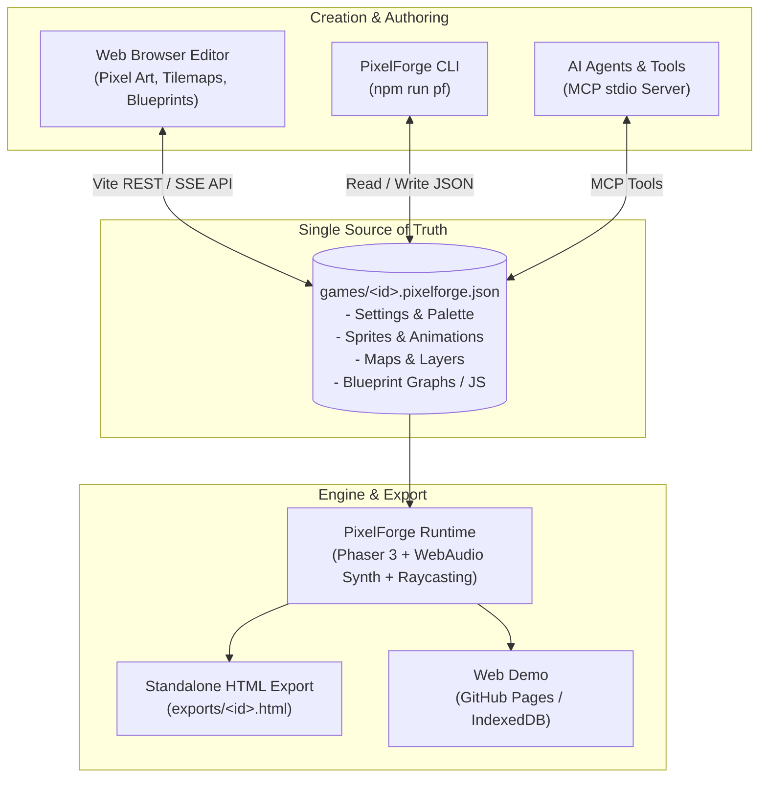

# PixelForge

[](https://github.com/dyzlek/pixelforge/actions/workflows/ci.yml)
[](LICENSE)
[](package.json)
[](https://vitejs.dev)
[](https://phaser.io)

> 🎮 **[Try the live web demo in your browser](https://dyzlek.github.io/pixelforge/)**  
> 🌐 Version française : **[README.md](README.md)**

**PixelForge** is a complete, browser-based 2D retro game engine and editor powered by **Phaser 3**.
Create pixel art sprites, build tilemap levels, program entity logic using **visual Blueprint node graphs** (inspired by Unreal Engine) or JavaScript, test immediately with zero build steps, and export standalone single-file HTML games.

One game = **one JSON file** (`games/<id>.pixelforge.json`). The web editor hot-reloads whenever disk files change: humans, CLI scripts, and AI agents over MCP can build and tweak games live!

---

## ⚡ 5-Minute Quick Start

### 1. Installation & Run
```bash
git clone https://github.com/dyzlek/pixelforge.git
cd pixelforge
npm install
npm run dev
```
Open your browser at **[http://localhost:5173](http://localhost:5173)**.

### 2. Make a Playable Character in 3 Steps
1. **Draw the Sprite** (*Pixel* tab): Pick a canvas size (e.g. 16x16), select colors from the Sweetie 16 palette, and paint your character.
2. **Configure Physics & Logic** (*Objects* tab):
   - Create an object named `Player`, assign your sprite, and enable physics (gravity + map collision).
   - In the Blueprint editor:
     - Place an **On Update** node (`pf_on_update`).
     - Wire to a **Branch** checking **Key Down (Right Arrow)**.
     - On true, wire to **Set Velocity X** (`self.vx = 100`).
     - Add an **On Key Down (Space)** node wired to **Jump** (`self.jump(250)`).
3. **Paint the Level & Play** (*Maps* and *Play* tabs):
   - Paint solid ground tiles on the collision layer.
   - Place the `Player` instance into the map.
   - Switch to the **Play** tab: control your character in real-time!
   - Click **Export** to generate a standalone `.html` file ready for itch.io or sharing.

---

## 🏗️ Architecture



---

## ✨ Features

- **Pixel Art Studio**: Pencil, eraser, paint bucket, color picker, line, shapes, rectangle selection, undo/redo, 16-color Sweetie 16 palette, frames and animations.
- **Tilemap Editor**: Multi-layer maps, solid collisions, one-way platforms, parallax scrolling factors, foreground/background layer sorting, multi-map navigation (`game.goToMap`).
- **Blueprint Visual Scripting**:
  - Over 160 typed nodes: Events, Flow Control (branches, loops, sequences, delays), Movement, Physics, Raycasting, Sound, Camera, Variables, Functions.
  - White execution wires and colored typed data wires (numbers, booleans, strings, instances, lists, colors).
  - DOM-free compiler generating clean JavaScript executed by Phaser.
  - Seamless toggle between Blueprint node graphs and CodeMirror JavaScript editor.
- **Audio Synthesizer**: Procedural 8-bit sound effects (jump, laser, coin, explosion, hit, powerup, portal) and chiptune music tracks via Web Audio API.
- **Standalone HTML Export**: Zero-install standalone export bundled into a single self-contained HTML file.

---

## 🤖 AI Agents & MCP Support

PixelForge is designed from the ground up for agentic AI pairing:
- Run the native stdio MCP server:
  ```bash
  npm run mcp
  ```
- Exposes 20 tools: `pixelforge_guide`, `create_game`, `upsert_sprite` (text-based ASCII sprites), `upsert_object` (with Blueprint graphs), `upsert_map`, `paint_map`, `place_entities`, `validate_game`, `export_html`.
- For complete agent documentation, see [AGENTS.md](AGENTS.md) and [llms.txt](llms.txt).

---

## 🛠️ Commands & Testing

```bash
npm install               # Install dependencies
npm run dev               # Start local dev server
npm run build             # Build production bundle (dist/)
npm test                  # Run full test suite (Blueprint compiler & MCP e2e)
npm run pf -- list        # CLI: list games
npm run pf -- validate <game>  # CLI: validate project
npm run pf -- render <game>    # CLI: ASCII level map preview
npm run pf -- export <game>    # CLI: build standalone HTML
```

---

## 📄 License

Licensed under the [MIT](LICENSE) License.
