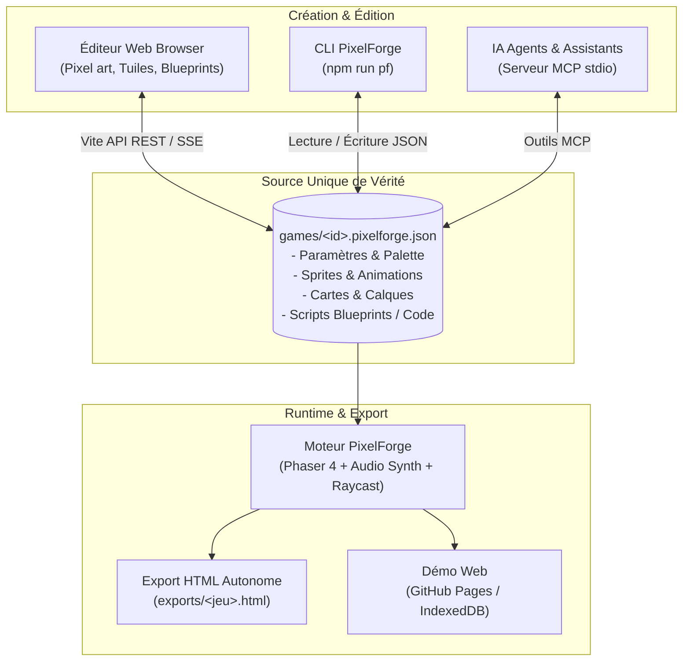

# PixelForge

[](https://github.com/dyzlek/pixelforge/actions/workflows/ci.yml)
[](LICENSE)
[](package.json)
[](https://vitejs.dev)
[](https://phaser.io)

> **[Essayer la démo en ligne dans votre navigateur](https://dyzlek.github.io/pixelforge/)**  
> Read this in English: **[README.en.md](README.en.md)**

**PixelForge** est un environnement complet de création de jeux vidéo 2D rétro directement dans le navigateur, propulsé par **Phaser 4**.
Dessinez vos sprites en pixel art, composez vos cartes en tuiles, programmez vos entités à l'aide de **Blueprints visuels** (graphes de nœuds inspirés d'Unreal Engine) ou directement en JavaScript, testez instantanément et exportez votre jeu en une seule page HTML autonome et partageable.

Un jeu = **un seul fichier JSON** (`games/<id>.pixelforge.json`). L'éditeur surveille le dossier `games/` et applique les modifications à chaud : vous, un script CLI ou une IA connectée en MCP pouvez concevoir ou modifier un jeu en direct !

---

## Démarrage rapide en 5 minutes

### 1. Installation et lancement
```bash
git clone https://github.com/dyzlek/pixelforge.git
cd pixelforge
npm install
npm run dev
```
Ouvrez votre navigateur sur **[http://localhost:5173](http://localhost:5173)**.

### 2. Créer un personnage en 3 étapes dans l'éditeur
1. **Dessiner le sprite** (onglet *Pixel*) : Choisissez une taille (ex. 16x16), sélectionnez une couleur dans la palette Sweetie 16 et dessinez votre personnage.
2. **Programmer la physique et le comportement** (onglet *Objets*) :
   - Créez un objet `Player`, assignez-lui le sprite créé et activez la physique (gravité + collision avec la carte).
   - Dans le script Blueprint :
     - Placez un nœud **À chaque image** (`pf_on_update`).
     - Branchez-le sur une branche conditionnelle vérifiant **Touche enfoncée (Flèche Droite)**.
     - Si vrai, reliez à **Définir vitesse x** (`self.vx = 100`).
     - Ajoutez un nœud **Touche appuyée (Espace)** relié à **Sauter** (`self.jump(250)`).
3. **Placer et Jouer** (onglet *Cartes* puis *Jouer*) :
   - Dessinez quelques plateformes solides sur le calque de collision.
   - Posez l'entité `Player` sur la scène.
   - Cliquez sur l'onglet **Jouer** : vous contrôlez immédiatement votre jeu !
   - Cliquez sur **Exporter** pour obtenir votre fichier `.html` prêt à être partagé sur itch.io ou par message.

---

## Architecture du projet



---

## Fonctionnalités détaillées

### Éditeur Pixel Art
- Outils complets : crayon, gomme, pot de peinture, pipette, tracé de lignes, rectangles, ellipses, sélection libre et déplacement.
- Palette Sweetie 16 par défaut (16 couleurs rétro sélectionnées pour un rendu cohérent).
- Tailles de grille de 8x8 à 256x256 avec aperçu en direct du facteur de zoom.
- Gestion d'animations multi-images (boucle, cadencement en fps).
- Création de *tilesets* : chaque image d'un sprite tileset correspond à une tuile utilisable dans les cartes.

### Concepteur de cartes et niveaux
- Outils de dessin de tuiles (pinceau, seau de remplissage, rectangle, pipette, sélection).
- Calques multiples avec paramètres avancés :
  - Calques de collision solide (`collides: true`).
  - Plateformes traversables par le bas (*one-way platforms*).
  - Facteur de défilement parallaxe (profondeur de champ).
  - Profondeur d'affichage (premier plan devant les entités ou arrière-plan).
- Prise en charge de cartes multiples par jeu avec téléportations inter-cartes via `game.goToMap(nom)`.

### Blueprints : Scripting visuel puissant
- **Nœuds et fils typés** :
  - Fils d'exécution blancs définissant l'ordonnancement séquentiel.
  - Fils de données colorés par type : nombres, booléens, chaînes, objets/instances, listes, couleurs.
- **Catalogue exhaustif (+160 nœuds)** :
  - *Événements* : Création (`create`), Mise à jour (`update`), Collision physique (`collide`), Chevauchement sans blocage (`overlap`), Début/fin de contact (`overlapStart` / `overlapEnd`), Clavier, Minuteur, Messages personnalisés.
  - *Flux de contrôle* : Branches `if / else`, boucles `for` / `while`, séquences, délais (`wait`).
  - *Physique et Mouvement* : Vitesses `vx`/`vy`, impulsions, sauts, frottements, rebonds, hitbox personnalisées, orientation (`flipX`, `flipY`).
  - *Système et Caméra* : Suivi de cible, cadrage dynamique, tremblements d'écran, score, variables de jeu.
  - *Audio rétro* : Jouer un effet ou déclencher des mélodies chiptune (`tetris`, `adventure`, `action`).
  - *Raycast* : Lancer de rayons physique pour tester la visibilité ou détecter des obstacles.
- **Compilateur sans dépendance DOM** : Les graphes sont compilés en JavaScript vanilla ultra-rapide exécutable dans Phaser.
- **Bascule instantanée Blueprint / Code** : Visualisez et éditez le code source JavaScript généré à tout moment.

### Synthèse sonore & Musique
- Générateur d'effets sonores intégré basé sur le Web Audio API (saut, tir laser, pièce, explosion, impact, bonus, portail) sans dépendances de fichiers externes.
- Pistes musicales chiptune prêtes à l'emploi.

### Export et distribution
- **Export HTML tout-en-un** : Génère un fichier unique contenant l'intégralité du jeu, les sons et les sprites.
- **Bibliothèque multi-projets** : Sauvegarde automatique locale (dossier disque en dev, IndexedDB sur le web).

---

## Raccourcis de l'éditeur Blueprint

| Action | Souris | Clavier (curseur sur le graphe) |
|---|---|---|
| **Palette d'actions** | Clic droit sur le fond ou bouton « + Nœud » | `Espace` ou `Tab` |
| **Relier deux broches** | Glisser d'une broche vers une autre | — |
| **Créer et relier un nœud** | Glisser depuis une broche et relâcher dans le vide | — |
| **Supprimer un lien** | `Alt` + Clic sur la broche ou le fil | `Suppr` ou `Retour arrière` |
| **Sélection rectangulaire** | Glisser sur le fond du graphe | `Ctrl + A` (tout sélectionner) |
| **Déplacer la vue** | Clic molette ou clic droit maintenu | Flèches |
| **Zoom** | Molette de la souris (25 % à 200 %) | — |
| **Copier / Coller / Dupliquer** | Clic droit sur un nœud | `Ctrl + C` / `Ctrl + V` / `Ctrl + D` |
| **Centrer / Cadrer** | Bouton « Recentrer » | `F` (cadrer la sélection) ou `Origine` |
| **Commenter la sélection** | Clic droit > « Entourer d'un commentaire » | `C` |

---

## Pour les IA : Serveur MCP et CLI

PixelForge a été pensé pour le pilotage autonome par des agents d'intelligence artificielle :

### Serveur MCP (Model Context Protocol)
PixelForge fournit un serveur MCP natif (`mcp/server.js`) activable avec :
```bash
npm run mcp
```
Il expose 20 outils spécialisés :
- `pixelforge_guide` : documentation de référence et règles d'or.
- `create_game`, `list_games`, `get_game`, `duplicate_game`, `delete_game`.
- `upsert_sprite` : création de sprites et tilesets à partir de matrices textuelles ASCII.
- `upsert_object` : création d'objets avec hitbox, physique et script Blueprint JSON.
- `upsert_map`, `paint_map`, `place_entities`, `render_map` : construction et rendu de niveaux.
- `validate_game` : vérification statique complète (0 erreurs, diagnostics précis).
- `export_html` : compilation et export du jeu.

Pour plus de détails, consultez [AGENTS.md](AGENTS.md) et [llms.txt](llms.txt).

### Outils CLI (`npm run pf`)
```bash
npm run pf -- list                      # Liste tous les jeux disponibles
npm run pf -- show <jeu>                # Affiche la fiche détaillée d'un jeu
npm run pf -- validate <jeu>            # Valide l'intégrité du projet et des scripts
npm run pf -- compile <jeu>             # Recompile les graphes Blueprint en JS
npm run pf -- render <jeu> [carte]      # Rendu ASCII textuel d'un niveau
npm run pf -- export <jeu>              # Exporte le jeu en fichier HTML autonome
npm run pf -- nodes [mot]               # Recherche dans le catalogue des nœuds Blueprint
```

---

## Commandes de développement et tests

```bash
npm install               # Installation des dépendances
npm run dev               # Serveur de développement avec rechargement à chaud
npm run build             # Build de production (dist/)
npm run preview           # Prévisualisation du build de production
npm test                  # Exécution de la suite complète de tests (graphes + e2e MCP)
```

Suite de validation stricte :
```bash
npm run build
npm test
npm run pf -- validate tetris
npm run pf -- validate exemple-plateforme-qiqv
npm run pf -- validate monde-1-1
```

---

## Structure du dépôt

```text
index.html, vite.config.js       Page de l'éditeur web et configuration Vite (+ API REST / SSE)
src/
  main.js                        Point d'entrée de l'application : gestion des onglets et sauvegardes
  core/                          Schéma du projet (project.js), store réactif, projet d'exemple
  editors/
    pixel/                       Éditeur de sprites et animations pixel art
    map/                         Éditeur de niveaux, de tuiles et placement d'entités
    sound/                       Générateur synthétisé et gestionnaire d'effets sonores
    objects/                     Gestion des objets, éditeur de graphes Blueprint et CodeMirror
  graph/                         Noyau sans DOM des Blueprints :
                                 - nodes.js (catalogue des nœuds)
                                 - compile.js (compilation graphe -> JavaScript)
                                 - fromBlockly.js (migration d'anciens blocs vers graphes)
  library/                       Bibliothèque de projets (stockage disque en dev, IndexedDB sur le web)
  runtime/                       Moteur d'exécution Phaser 4 (engine.js sans import) et export HTML
mcp/                             Serveur MCP (server.js), CLI (cli.js), utilitaires et tests e2e
games/                           Jeux au format JSON : Tetris rétro, Monde 1-1, Exemple plateforme
docs/                            Spécifications techniques : ARCHITECTURE.md, BLUEPRINTS.md, SCRIPT_API.md
```

---

## Feuille de route & Contribution

Consultez **[ROADMAP.md](ROADMAP.md)** pour découvrir les chantiers en cours et les évolutions futures.  
Pour contribuer au projet, lisez le guide **[CONTRIBUTING.md](CONTRIBUTING.md)** ainsi que le **[CODE_OF_CONDUCT.md](CODE_OF_CONDUCT.md)**.

## Licence

Ce projet est sous licence [MIT](LICENSE).
